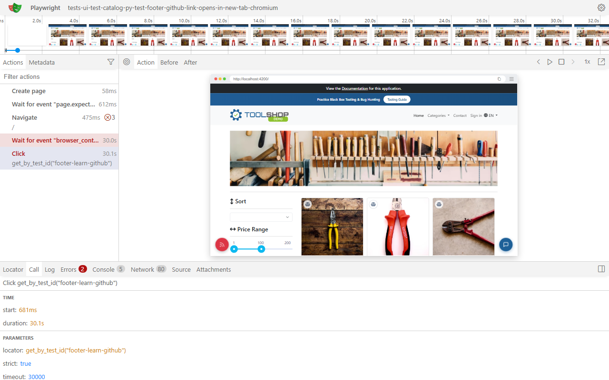
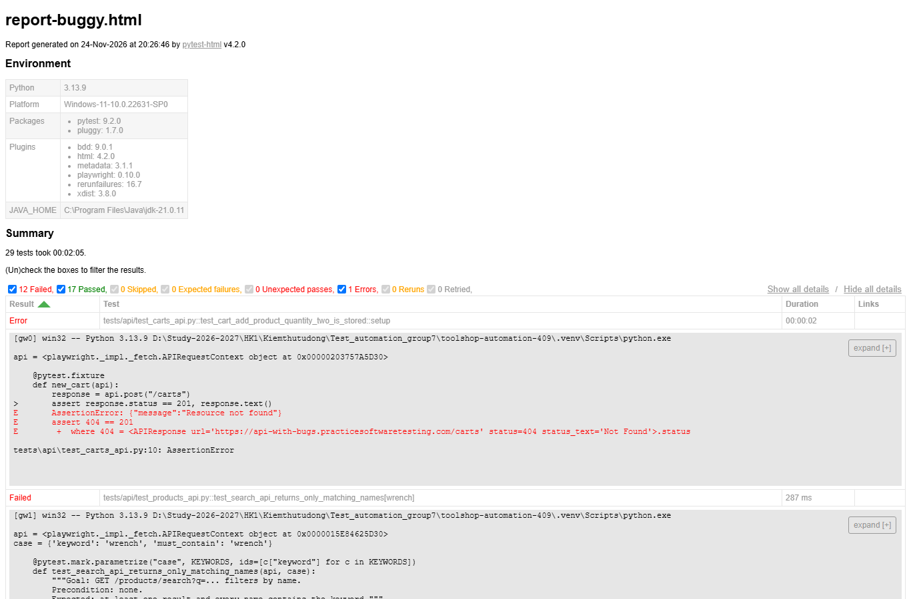
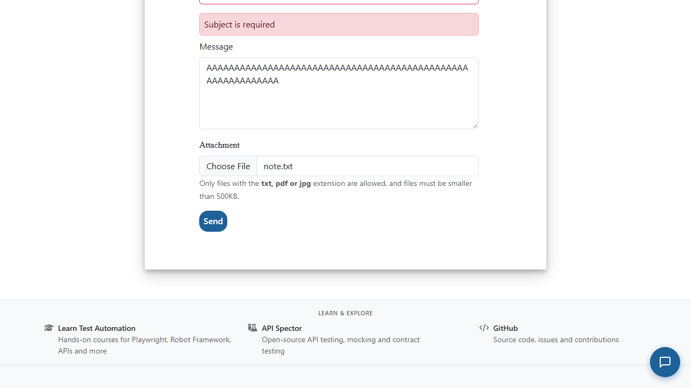
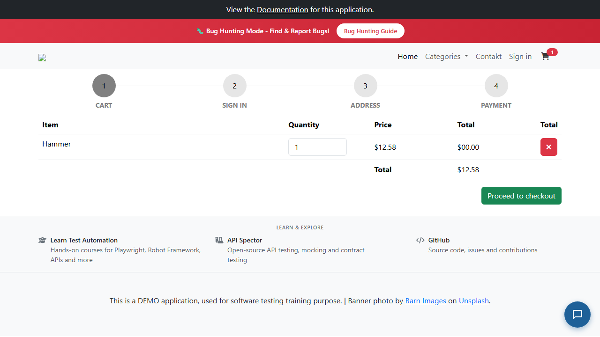

# toolshop-automation-409


Bộ kiểm thử tự động (End-to-End UI, REST API, Network Route/Mocking, BDD) cho website thương mại điện tử **Toolshop** (`practicesoftwaretesting.com`) xây dựng bằng **Playwright + Pytest (Python)** theo mô hình **Page Object Model (POM)** và tích hợp **GitHub Actions CI/CD**.

---

## 1. Phân công công việc

| Thành viên (GitHub) | Vai trò / Hạng mục phụ trách | Pull Request |
|---|---|---|
| **Tvuong123com** (Vương) | Khởi tạo repo, bảo vệ nhánh `main`, dựng khung kiểm thử (`conftest.py`, `pytest.ini`, `pages/`), viết 4 test Smoke (`tests/ui/test_smoke.py`), review PR #2 | PR #1 (`feature/vuong-sprint1`) |
| **Nhanoccho** (Nhân) | Bộ test API (`tests/api/`), test chặn/giả lập mạng (`tests/ui/test_network.py`), data-driven JSON (`data/search_keywords.json`), 12+ test UI phủ 6 nhóm chức năng & 3 tình huống đặc biệt (thanh trượt, tải tệp, tab mới) | PR #2 (`feature/nhan-sprint2`) |
| **phudang0611-beep** (Đăng) | Bộ test BDD (`tests/bdd/`), cấu hình CI/CD 3 trình duyệt (`chromium`, `firefox`, `webkit`) kèm Docker Toolshop (`toolshop/`, `.github/workflows/ci.yml`), chụp bằng chứng CI & Trace Viewer, cấu hình job Regression BUGGY, tổng hợp `docs/BUG_REPORT.md` & hoàn thiện `README.md` | PR #3 (`feature/dang-sprint2b`), PR #4 (`sprint-3`) |

---

## 2. Cấu trúc dự án

```text
toolshop-automation-409/
├── .github/workflows/ci.yml     # CI 3 trình duyệt (PROD Docker) + job regression (BUGGY Docker)
├── pages/                       # Page Object Model (BasePage, Home, Product, Cart, Login, Contact, Account)
├── tests/
│   ├── ui/                      # Test giao diện (smoke, catalog, cart, auth, contact, network)
│   ├── api/                     # Test REST API bằng APIRequestContext (products, users, carts)
│   └── bdd/                     # Kịch bản Gherkin (features/cart_flow.feature) + step definitions
├── data/search_keywords.json    # Dữ liệu JSON cho test data-driven
├── docs/
│   ├── BUG_REPORT.md            # Báo cáo lỗi phát hiện trên môi trường BUGGY
│   └── screenshots/             # Ảnh CI xanh, Trace Viewer và bằng chứng lỗi BUG-002..BUG-008
├── toolshop/                    # Docker Compose & script khởi tạo Toolshop cục bộ cho CI
├── conftest.py                  # Fixture dùng chung (2 scope: session, function; storage_state)
├── pytest.ini                   # Khai báo marker & đường dẫn BDD features
├── requirements.txt             # Thư viện Python cố định phiên bản
└── .env.example                 # Mẫu biến môi trường (BASE_URL, API_URL, ROUTE_PREFIX)
```

---

## 3. Hướng dẫn cài đặt và chạy

### 3.1. Cài đặt môi trường (Python 3.12+)

**Windows (PowerShell):**
```powershell
git clone https://github.com/Tvuong123com/toolshop-automation-409.git
cd toolshop-automation-409
python -m venv .venv
.venv\Scripts\activate
pip install -r requirements.txt
playwright install chromium
copy .env.example .env
```

**macOS / Linux:**
```bash
git clone https://github.com/Tvuong123com/toolshop-automation-409.git
cd toolshop-automation-409
python3 -m venv .venv
source .venv/bin/activate
pip install -r requirements.txt
playwright install chromium
cp .env.example .env
```

> **Lưu ý:** Mọi URL đều được đọc từ biến môi trường / tệp `.env` (`BASE_URL`, `API_URL`, `ROUTE_PREFIX`), không hard-code trong mã nguồn. Tệp `.env` đã nằm trong `.gitignore`.

### 3.2. Các lệnh chạy kiểm thử trên PROD

```bash
pytest                          # Chạy toàn bộ bộ test (30 test cases)
pytest -m smoke                 # Chỉ chạy 4 test smoke nhanh
pytest -m api -v                # Chỉ chạy 10 test API
pytest -m ui -v                 # Chỉ chạy các test giao diện
pytest tests/bdd -v             # Chỉ chạy các kịch bản BDD
pytest -n auto                  # Chạy song song trên máy cá nhân bằng pytest-xdist
pytest --headed --slowmo 300    # Chạy có giao diện để quan sát
pytest --tracing retain-on-failure --screenshot only-on-failure --html=report.html --self-contained-html
```

### 3.3. Chạy kiểm thử hồi quy (Regression) trên BUGGY

Không sửa code test hay assertion; chỉ đổi cấu hình qua biến môi trường:

**Windows (PowerShell):**
```powershell
$env:BASE_URL="https://with-bugs.practicesoftwaretesting.com"
$env:API_URL="https://api-with-bugs.practicesoftwaretesting.com"
$env:ROUTE_PREFIX="/#"
pytest -n 2 -v --tracing retain-on-failure --screenshot only-on-failure
```

**macOS / Linux:**
```bash
BASE_URL=https://with-bugs.practicesoftwaretesting.com \
API_URL=https://api-with-bugs.practicesoftwaretesting.com \
ROUTE_PREFIX=/# \
pytest -n 2 -v --tracing retain-on-failure --screenshot only-on-failure
```

---

## 4. Bảng Test Case (30 Test Cases)

### 4.1. Test Giao diện (UI) & Route / Mocking

| ID | Chức năng | Mô tả | Các bước thực hiện | Input data | Kết quả mong đợi |
|---|---|---|---|---|---|
| TC-UI-01 | Tìm kiếm (`smoke`) | Tìm sản phẩm theo từ khóa hợp lệ | Mở trang chủ → nhập từ khóa → bấm Search | `pliers` | Hiện `search_completed`, caption chứa `pliers`, mọi tên sản phẩm đều chứa `pliers` |
| TC-UI-02 | Chi tiết sản phẩm (`smoke`) | Thêm sản phẩm vào giỏ với số lượng 3 | Mở trang chủ → mở `Claw Hammer` → nhập SL `3` → bấm Add to cart | `Claw Hammer`, SL `3` | Toast chứa `"Product added to shopping cart"`, badge giỏ hàng hiện `3` |
| TC-UI-03 | Xác thực (`smoke`) | Đăng nhập bằng tài khoản không tồn tại | Mở `/auth/login` → nhập email/mật khẩu sai → bấm Login | `nobody-here@example.com` / `Wrong-Password-123` | Hiện `"Invalid email or password"`, URL vẫn kết thúc bằng `/auth/login` |
| TC-UI-04 | Liên hệ (`smoke`) | Gửi form liên hệ bỏ trống | Mở `/contact` → không điền gì → bấm Send | *(trống)* | Hiện thông báo `"Subject is required"` và `"Message is required"` |
| TC-UI-05 | Tìm kiếm | Tìm từ khóa không có kết quả | Mở trang chủ → tìm từ khóa không tồn tại | `zzz-no-such-tool` | Hiện `"There are no products found."` và 0 thẻ sản phẩm |
| TC-UI-06 | Sắp xếp (`parametrize`) | Sắp xếp sản phẩm theo giá tăng dần | Mở trang chủ → chọn `price,asc` ở ô Sort | `price,asc` | Danh sách giá trên trang đầu tăng dần |
| TC-UI-07 | Sắp xếp (`parametrize`) | Sắp xếp sản phẩm theo giá giảm dần | Mở trang chủ → chọn `price,desc` ở ô Sort | `price,desc` | Danh sách giá trên trang đầu giảm dần |
| TC-UI-08 | Bộ lọc danh mục | Lọc theo danh mục `Hammer` | Mở trang chủ → tích checkbox `Hammer` | `Hammer` | Hiện `filter_completed`, mọi sản phẩm hiển thị chứa `hammer` |
| TC-UI-09 | Bộ lọc giá (Thanh trượt) | Hạ mức giá tối đa trên thanh trượt về 20 | Mở trang chủ → focus nút kéo phải thanh trượt → nhấn phím giảm về `20` | `max = 20` | `aria-valuenow="20"`, không có sản phẩm giá > `$20` |
| TC-UI-10 | Chi tiết sản phẩm | Kiểm tra tên và đơn giá sản phẩm | Mở trang chủ → bấm vào `Combination Pliers` | `Combination Pliers` | Tiêu đề trang chi tiết là `Combination Pliers`, đơn giá > 0 |
| TC-UI-11 | Tab mới | Link GitHub ở chân trang mở tab mới | Mở trang chủ → bấm `footer-learn-github` và bắt sự kiện `expect_page` | *(click)* | Mở tab mới có URL khớp `github.com/.+/practice-software-testing` |
| TC-UI-12 | Giỏ hàng | Kiểm tra tính tiền theo dòng và tổng giỏ | Mở `Claw Hammer` → thêm SL `2` → vào giỏ hàng | `Claw Hammer`, SL `2` | Giá dòng = `đơn giá × 2`; tổng giỏ = tổng các dòng |
| TC-UI-13 | Giỏ hàng | Nút Continue Shopping quay lại trang chủ | Thêm `Hammer` vào giỏ → vào giỏ hàng → bấm `Continue Shopping` | `Hammer` | Quay lại trang chủ và danh sách sản phẩm hiển thị |
| TC-UI-14 | Xác thực | Kiểm tra lỗi bắt buộc khi form đăng nhập trống | Mở `/auth/login` → bấm Login khi chưa nhập dữ liệu | *(trống)* | Hiện `"Email is required"` và `"Password is required"` |
| TC-UI-15 | Tài khoản (`storage_state`) | Truy cập trang tài khoản bằng phiên đã đăng nhập | Dùng fixture `logged_in_page` → mở `/account` | Tài khoản `test_user` (session) | Tiêu đề là `"My account"`, menu hiển thị `"QA Bot"` |
| TC-UI-16 | Liên hệ (Tải tệp lên) | Gửi form liên hệ kèm tệp rỗng 0-byte | Mở `/contact` → điền đủ thông tin → đính kèm tệp `note.txt` (0 byte) → bấm Send | `note.txt` (0 byte), `webmaster` | Hiện thông báo thành công `"Thanks for your message!"` |
| TC-UI-17 | Route / Mocking | Chặn tải ảnh nhưng danh mục vẫn hoạt động | Đăng ký `page.route` abort ảnh (`.png/.jpg/.webp/...`) → mở trang chủ | Regex đuôi ảnh | Danh sách tên sản phẩm vẫn hiển thị và có ít nhất 1 request ảnh bị chặn |
| TC-UI-18 | Route / Mocking | Giả lập API `/products` trả về danh sách rỗng | Đăng ký `page.route` trả `EMPTY_PAGE` (HTTP 200) → mở trang chủ | `data: [], total: 0` | Hiện `"There are no products found."` và 0 thẻ sản phẩm |

### 4.2. Test REST API (`APIRequestContext`)

| ID | Chức năng | Mô tả | Các bước thực hiện | Input data | Kết quả mong đợi |
|---|---|---|---|---|---|
| TC-API-01 | Products API | Kiểm tra hợp đồng JSON phân trang `GET /products` | Gọi `GET /products?page=1` | `page=1` | HTTP 200; đủ khóa `current_page`, `data`, `per_page`, `total`, `last_page`; `0 < len(data) <= per_page`; mỗi sản phẩm có `id` (`str`/`int`), `name` không rỗng, `price > 0` |
| TC-API-02..05 | Search API (`parametrize` JSON) | Tìm kiếm theo dữ liệu từ `data/search_keywords.json` (4 từ khóa) | Gọi `GET /products/search?q=<keyword>` cho từng dòng JSON | `pliers`, `hammer`, `saw`, `wrench` | HTTP 200; có ít nhất 1 kết quả; mọi tên sản phẩm đều chứa từ khóa tương ứng |
| TC-API-06 | Auth API (`parametrize`) | Gọi endpoint cần xác thực khi không có token | Gọi `GET /users/me` không kèm header Authorization | *(không token)* | HTTP `401` |
| TC-API-07 | Products API (`parametrize`) | Truy vấn sản phẩm không tồn tại | Gọi `GET /products/does-not-exist` | `id = does-not-exist` | HTTP `404` |
| TC-API-08 | Users API | Kiểm tra validation phía server khi đăng ký thiếu dữ liệu | Gọi `POST /users/register` với `data={}` | `{}` | HTTP `422`; JSON lỗi có khóa `email` và `password` |
| TC-API-09 | Users API (Token) | Lấy thông tin cá nhân bằng Bearer token | Gọi `GET /users/me` kèm `auth_headers` của `test_user` | Bearer token từ fixture | HTTP `200`; trường `email` khớp `test_user["email"]` |
| TC-API-10 | Carts API (`POST` + `GET`) | Tạo giỏ mới, thêm sản phẩm SL 2 và đọc lại giỏ | Fixture `new_cart` (`POST /carts`) → `POST /carts/{id}` → `GET /carts/{id}` | Sản phẩm đầu tiên, `quantity=2` | Tạo giỏ `201`; thêm thành công; `GET` trả về 1 mục với `quantity == 2` và đúng `product_id` |

### 4.3. Test BDD (`pytest-bdd`)

| ID | Chức năng | Mô tả | Các bước thực hiện | Input data (`Examples`) | Kết quả mong đợi |
|---|---|---|---|---|---|
| TC-BDD-01 | Shopping Cart Flow | Tìm kiếm → mở sản phẩm → thêm giỏ → kiểm tra tính tiền | Theo kịch bản `tests/bdd/features/cart_flow.feature` | `Pliers` / `Pliers` / SL `2` | Giỏ hiện đúng sản phẩm, giá dòng = `đơn giá × 2`, tổng giỏ = tổng các dòng |
| TC-BDD-02 | Shopping Cart Flow | Tìm kiếm → mở sản phẩm → thêm giỏ → kiểm tra tính tiền | Theo kịch bản `tests/bdd/features/cart_flow.feature` | `Hammer` / `Claw Hammer` / SL `3` | Giỏ hiện đúng sản phẩm, giá dòng = `đơn giá × 3`, tổng giỏ = tổng các dòng |

---

## 5. Kết quả CI & Trace Viewer

### Kết quả CI (3 trình duyệt: Chromium, Firefox, WebKit)


### Trace Viewer (Gỡ lỗi lượt chạy đỏ)



---

## 6. Kết quả Regression trên BUGGY

Job `regression (BUGGY)` trong `.github/workflows/ci.yml` chạy nguyên bộ test (không sửa code test/assertion) với cấu hình `SPRINT=sprint5-with-bugs` và `ROUTE_PREFIX=/#`, đặt `continue-on-error: true` và upload artifact `report-buggy`.

- **Số lỗi thật phát hiện được:** **8 lỗi thật (`BUG-001` → `BUG-008`)** đều xanh trên PROD, đỏ trên BUGGY, kèm bằng chứng ảnh chụp trong `docs/screenshots/BUG-001.png` → `BUG-008.png`.
- **Phân loại khác biệt môi trường (2 test, không tính lỗi):** `POST /carts` không tồn tại trên BUGGY (`404`) và BUGGY lưu token ở `sessionStorage` thay vì `localStorage`.
- Xem chi tiết đầy đủ tại: [docs/BUG_REPORT.md](docs/BUG_REPORT.md).

### Ảnh kết quả chạy thực tế trên BUGGY (`pytest-html`)



### Ảnh bằng chứng các lỗi phát hiện trên BUGGY

| Mã lỗi | Mô tả ngắn | Ảnh bằng chứng |
|---|---|---|
| **BUG-001** | Search API `q=wrench` trả sản phẩm sai |  |
| **BUG-002** | Giá dòng giỏ hàng luôn hiển thị `$0.00` |  |
| **BUG-003** | Thêm giỏ hàng hiện toast lỗi `"Oeps, something went wrong."` |  |
| **BUG-004** | Form đăng nhập trống không hiện lỗi từng trường |  |
| **BUG-005** | Không hiện `"There are no products found."` |  |
| **BUG-006** | Form Liên hệ báo `"Subject is required"` dù đã chọn Subject |  |
| **BUG-007** | Trang giỏ hàng thiếu nút `"Continue Shopping"` |  |
| **BUG-008** | Thanh trượt giá tối đa không lọc sản phẩm |  |

---

## 7. Phần có AI hỗ trợ

Nhóm có sử dụng trợ lý AI trong quá trình hoàn thiện Sprint 3 ở các hạng mục sau (mọi dòng code và tài liệu đều đã được nhóm tự kiểm tra, chạy kiểm chứng thực tế trên cả PROD và BUGGY và hiểu rõ để giải thích khi vấn đáp):

| Hạng mục có AI hỗ trợ | Nội dung AI hỗ trợ | Nhóm rà soát & kiểm chứng |
|---|---|---|
| Cấu hình job `test-buggy` trong `.github/workflows/ci.yml` | Đề xuất cấu hình job chạy Docker BUGGY (`SPRINT: sprint5-with-bugs`, `ROUTE_PREFIX: /#`, `continue-on-error: true`, artifact `report-buggy`) | Đối chiếu từng yêu cầu Mục 3.12, đảm bảo không sửa test/assertion và không dùng URL công khai trên CI |
| Phân loại kết quả chạy BUGGY & biên soạn `docs/BUG_REPORT.md` | Tổng hợp log lỗi từ lần chạy `pytest` thực tế trên `with-bugs.practicesoftwaretesting.com`, tách lỗi thật và khác biệt môi trường | Tự chạy trực tiếp trên cả PROD (30/30 passed) và BUGGY, kiểm tra lại từng ảnh chụp bằng chứng `BUG-002.png` → `BUG-008.png`, gộp các test trùng nguyên nhân gốc |
| Hoàn thiện tài liệu `README.md` | Chuẩn hóa bảng Test Case (30 TCs) và hướng dẫn chạy theo mẫu Mục 4 đề bài | Kiểm đối chiếu từng ID/tên hàm với mã nguồn thực tế trong `tests/` và `pages/` |
