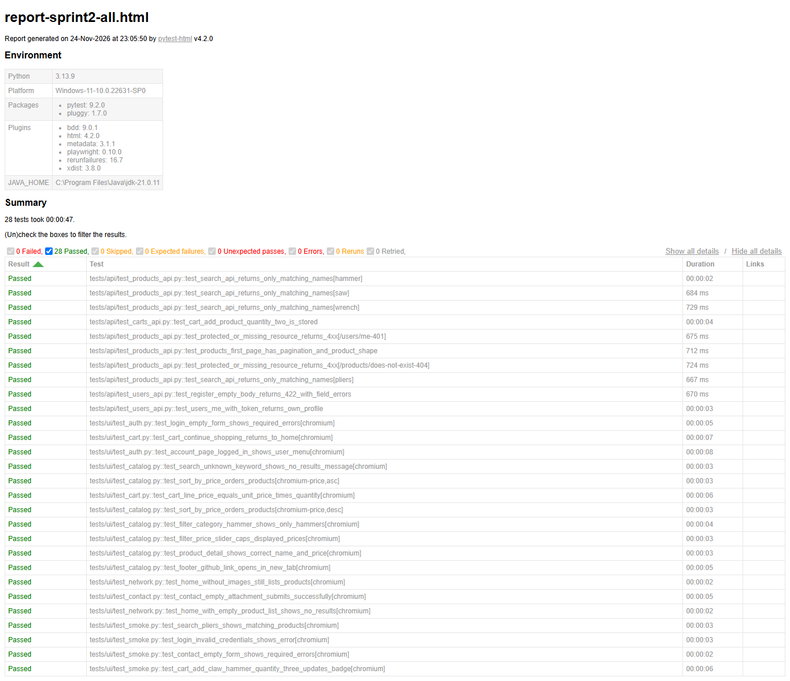
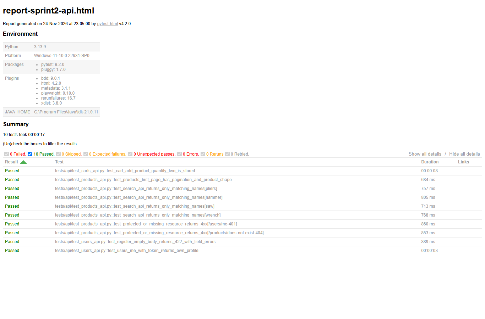

# toolshop-automation-409 — Sprint 2 (Nửa đầu)

Bộ kiểm thử tự động cho website thương mại điện tử **Toolshop** (`practicesoftwaretesting.com`) xây dựng bằng **Playwright + Pytest (Python)** theo mô hình **Page Object Model (POM)**.

Nhánh `feature/nhan-sprint2` hoàn thiện toàn bộ yêu cầu **nửa đầu Sprint 2** (`docs/sprint-2.md`): test REST API (`APIRequestContext`), chặn & giả lập mạng (`page.route`), data-driven (`parametrize` + JSON), fixture 2 scope + `storage_state` + marker, và **18 test giao diện** phủ đủ 6 nhóm chức năng cùng 3 tình huống đặc biệt (thanh trượt, tải tệp lên, tab mới).

---

## 1. Đối chiếu yêu cầu Sprint 2

| Hạng mục (Đề mục) | Yêu cầu tối thiểu | Thực hiện trên nhánh `feature/nhan-sprint2` |
|---|---|---|
| **Test API (3.5)** | ≥ 5 test API bằng `APIRequestContext` (≥ 2 HTTP method, lỗi 4xx, cấu trúc JSON, có token) | **10 test API** tại `tests/api/test_products_api.py`, `test_users_api.py`, `test_carts_api.py` (`POST` & `GET`, lỗi `401`/`404`/`422`, JSON contract, Bearer token) |
| **Route / Mocking (3.6)** | 2 test dùng `page.route()` (1 chặn tài nguyên, 1 giả lập phản hồi) | **2 test** tại `tests/ui/test_network.py`: chặn ảnh và mock danh sách sản phẩm rỗng |
| **Data-driven (3.3)** | ≥ 2 test `@pytest.mark.parametrize` (≥ 1 đọc JSON/CSV) | **3 test `parametrize`**: tìm kiếm API đọc từ `data/search_keywords.json` (4 từ khóa), lỗi 4xx (`401`/`404`), sắp xếp giá (`price,asc` / `price,desc`) |
| **Fixture & Marker (3.4)** | `conftest.py` có ≥ 2 scope, đăng nhập 1 lần dùng `storage_state`, ≥ 3 marker | `session` (`api`, `test_user`, `auth_token`, `auth_headers`, `auth_state`) & `function` (`logged_in_page` dùng tại `tests/ui/test_auth.py`); 7 marker trong `pytest.ini` |
| **Test giao diện (3.2)** | ≥ 12 test phủ đủ 6 nhóm chức năng + 3 tình huống (thanh trượt, tải tệp, tab mới) | **18 test UI** (16 chức năng + 2 route) phủ đủ 6 nhóm và cả thanh trượt giá, tải tệp rỗng 0-byte, mở tab mới GitHub |

---

## 2. Cấu trúc dự án

```text
toolshop-automation-409/
├── pages/                       # Page Object Model (BasePage, Home, Product, Cart, Login, Contact, Account)
├── tests/
│   ├── ui/                      # 18 test giao diện (smoke, catalog, cart, auth, contact, network)
│   └── api/                     # 10 test REST API bằng APIRequestContext (products, users, carts)
├── data/search_keywords.json    # Dữ liệu JSON cho test API tìm kiếm data-driven
├── docs/screenshots/            # Ảnh chụp kết quả chạy kiểm thử thực tế
├── conftest.py                  # Fixture dùng chung (session & function scope, storage_state)
├── pytest.ini                   # Khai báo marker (smoke, ui, api, regression...)
├── requirements.txt             # Danh sách thư viện Python
└── .env.example                 # Mẫu biến môi trường (BASE_URL, API_URL)
```

---

## 3. Hướng dẫn cài đặt và chạy

### 3.1. Cài đặt môi trường

```powershell
# Windows (PowerShell)
python -m venv .venv
.venv\Scripts\activate
pip install -r requirements.txt
playwright install chromium
copy .env.example .env
```

```bash
# macOS / Linux
python3 -m venv .venv
source .venv/bin/activate
pip install -r requirements.txt
playwright install chromium
cp .env.example .env
```

### 3.2. Lệnh chạy & kiểm tra nghiệm thu Sprint 2

```bash
pytest --collect-only -q        # Liệt kê đủ 28 test (10 API + 18 UI/Route)
pytest -m api -v                # Chạy 10 test API → 10 passed
pytest -m smoke -v              # Chạy 4 test smoke → 4 passed
pytest -n 2                     # Chạy toàn bộ 28 test song song → 28 passed
```

---

## 4. Bảng Test Case (28 Test Cases)

### 4.1. Test Giao diện (UI) & Route / Mocking (18 Test Cases)

| ID | Nhóm chức năng | File & Hàm test | Input data | Kết quả mong đợi |
|---|---|---|---|---|
| TC-UI-01 | Danh sách & tìm kiếm (`smoke`) | `test_smoke.py::test_search_pliers_shows_matching_products` | `pliers` | Hiện `search_completed`, caption chứa `pliers`, mọi tên sản phẩm chứa `pliers` |
| TC-UI-02 | Chi tiết sản phẩm (`smoke`) | `test_smoke.py::test_cart_add_claw_hammer_quantity_three_updates_badge` | `Claw Hammer`, SL `3` | Toast chứa `"Product added to shopping cart"`, badge giỏ hiện `3` |
| TC-UI-03 | Xác thực (`smoke`) | `test_smoke.py::test_login_invalid_credentials_shows_error` | `nobody-here@example.com` | Hiện `"Invalid email or password"`, giữ nguyên `/auth/login` |
| TC-UI-04 | Liên hệ (`smoke`) | `test_smoke.py::test_contact_empty_form_shows_required_errors` | *(trống)* | Hiện `"Subject is required"` và `"Message is required"` |
| TC-UI-05 | Danh sách & tìm kiếm | `test_catalog.py::test_search_unknown_keyword_shows_no_results_message` | `zzz-no-such-tool` | Hiện `"There are no products found."` và 0 thẻ sản phẩm |
| TC-UI-06..07 | Danh sách & tìm kiếm (`parametrize`) | `test_catalog.py::test_sort_by_price_orders_products` | `price,asc`, `price,desc` | Danh sách giá trang đầu đúng thứ tự tăng dần / giảm dần |
| TC-UI-08 | Bộ lọc danh mục | `test_catalog.py::test_filter_category_hammer_shows_only_hammers` | `Hammer` | Hiện `filter_completed`, mọi sản phẩm hiển thị chứa `hammer` |
| TC-UI-09 | Bộ lọc giá (**Thanh trượt**) | `test_catalog.py::test_filter_price_slider_caps_displayed_prices` | `max = 20` | `aria-valuenow="20"`, mọi giá sản phẩm hiển thị ≤ `$20` |
| TC-UI-10 | Chi tiết sản phẩm | `test_catalog.py::test_product_detail_shows_correct_name_and_price` | `Combination Pliers` | Tên sản phẩm khớp `"Combination Pliers"`, đơn giá > 0 |
| TC-UI-11 | Chân trang (**Tab mới**) | `test_catalog.py::test_footer_github_link_opens_in_new_tab` | Link GitHub | Mở tab mới có URL trỏ tới `github.com/.+/practice-software-testing` |
| TC-UI-12 | Giỏ hàng | `test_cart.py::test_cart_line_price_equals_unit_price_times_quantity` | `Claw Hammer`, SL `2` | Giá dòng = `đơn giá × 2`; tổng giỏ = tổng các dòng |
| TC-UI-13 | Giỏ hàng | `test_cart.py::test_cart_continue_shopping_returns_to_home` | `Hammer` | Bấm `Continue Shopping` quay lại trang chủ hiện danh sách sản phẩm |
| TC-UI-14 | Xác thực | `test_auth.py::test_login_empty_form_shows_required_errors` | *(trống)* | Hiện `"Email is required"` và `"Password is required"` |
| TC-UI-15 | Tài khoản (`storage_state`) | `test_auth.py::test_account_page_logged_in_shows_user_menu` | Fixture `logged_in_page` | Tiêu đề `"My account"`, menu hiển thị `"QA Bot"` |
| TC-UI-16 | Liên hệ (**Tải tệp lên**) | `test_contact.py::test_contact_empty_attachment_submits_successfully` | `note.txt` (0 byte), `webmaster` | Hiện thông báo thành công `"Thanks for your message!"` |
| TC-UI-17 | Route / Mocking | `test_network.py::test_home_without_images_still_lists_products` | Abort ảnh (`.png/.jpg/...`) | Danh sách sản phẩm vẫn hiển thị và có request ảnh bị chặn |
| TC-UI-18 | Route / Mocking | `test_network.py::test_home_with_empty_product_list_shows_no_results` | Mock `EMPTY_PAGE` | Hiện `"There are no products found."` và 0 thẻ sản phẩm |

### 4.2. Test REST API (10 Test Cases)

| ID | Chức năng | File & Hàm test | Input data | Kết quả mong đợi |
|---|---|---|---|---|
| TC-API-01 | Products API (JSON Contract) | `test_products_api.py::test_products_first_page_has_pagination_and_product_shape` | `page=1` | HTTP 200; đủ khóa phân trang; `id` (`str`/`int`), `name` không rỗng, `price > 0` |
| TC-API-02..05 | Search API (`parametrize` JSON) | `test_products_api.py::test_search_api_returns_only_matching_names` | `pliers`, `hammer`, `saw`, `wrench` | HTTP 200; có kết quả và mọi tên sản phẩm chứa từ khóa |
| TC-API-06..07 | Error Handling (`parametrize` 4xx) | `test_products_api.py::test_protected_or_missing_resource_returns_4xx` | `/users/me`, `/products/does-not-exist` | Trả về đúng HTTP `401` và `404` |
| TC-API-08 | Users API (422) | `test_users_api.py::test_register_empty_body_returns_422_with_field_errors` | `data={}` | HTTP `422`; JSON lỗi chứa khóa `email` và `password` |
| TC-API-09 | Users API (Bearer Token) | `test_users_api.py::test_users_me_with_token_returns_own_profile` | `auth_headers` | HTTP `200`; `email` khớp tài khoản `test_user` |
| TC-API-10 | Carts API (`POST` & `GET`) | `test_carts_api.py::test_cart_add_product_quantity_two_is_stored` | Fixture `new_cart`, SL `2` | Tạo giỏ `201`; thêm sản phẩm thành công; `GET` trả đúng 1 dòng với `quantity == 2` |

---

## 5. Kết quả chạy kiểm thử thực tế

### 5.1. Toàn bộ 28 test Sprint 2 (`pytest -n 2` → 28 passed)



### 5.2. Bộ 10 test API (`pytest -m api -v` → 10 passed)


