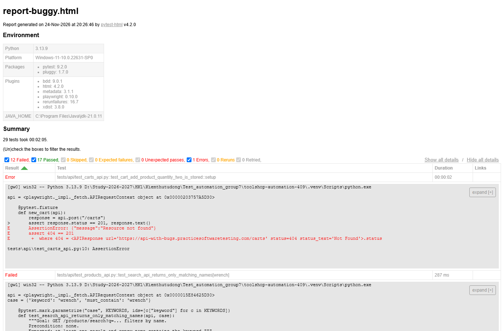
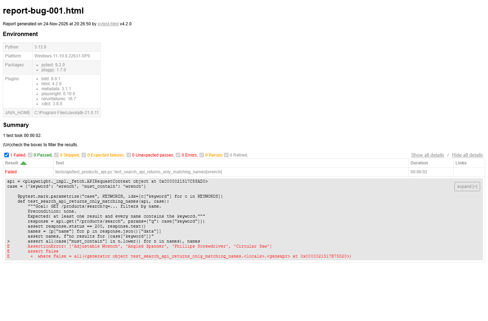
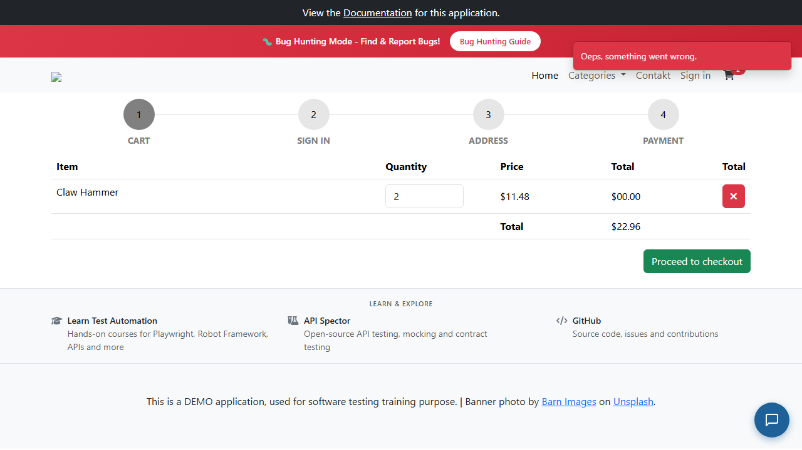
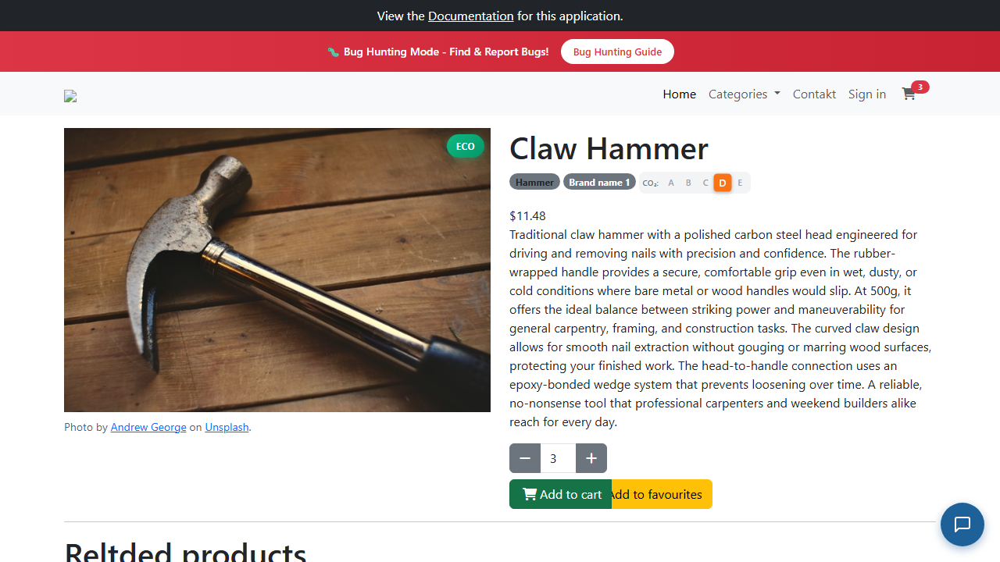
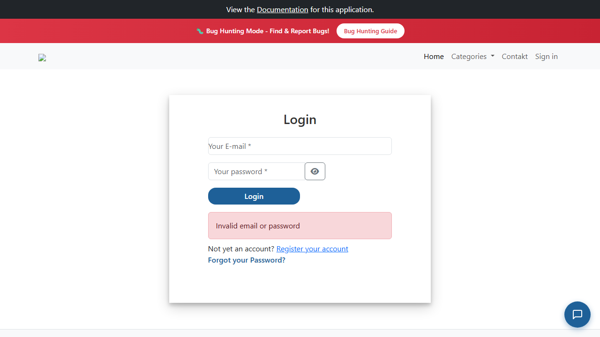
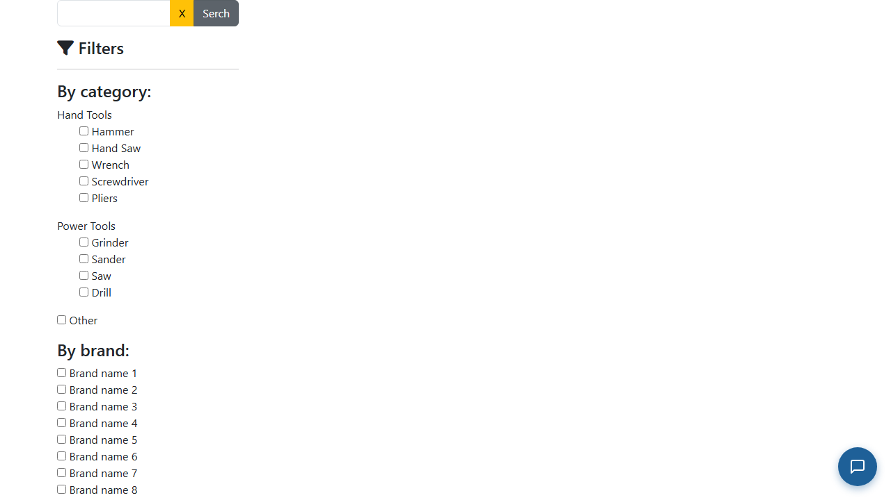
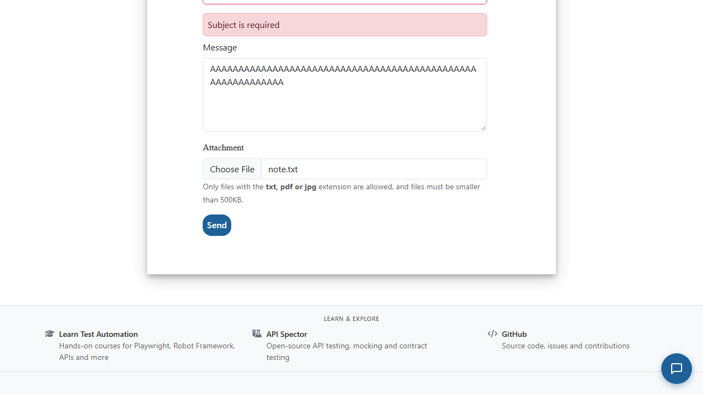
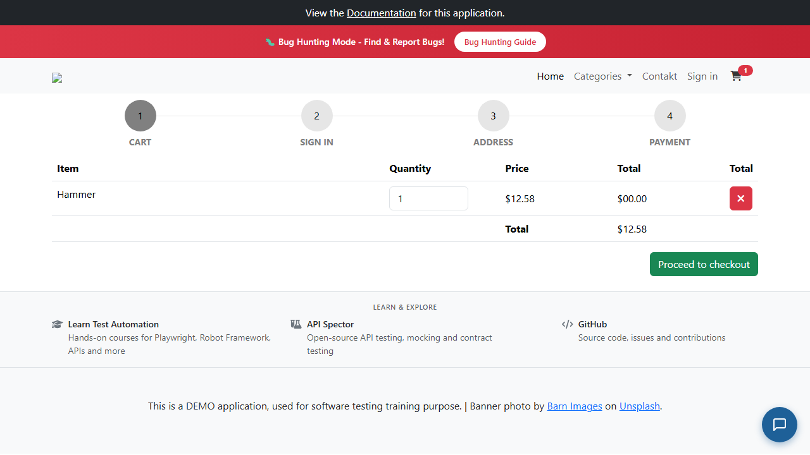
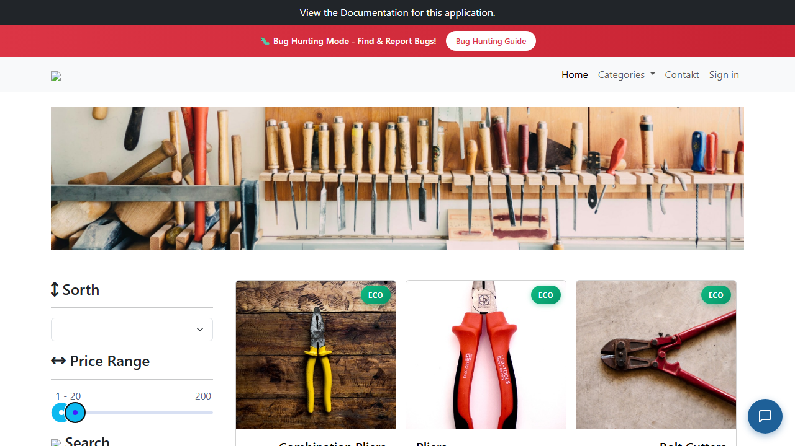

# BUG_REPORT - Toolshop BUGGY

Một lỗi được tính khi: **xanh trên PROD, đỏ trên BUGGY**, có bằng chứng đính kèm (screenshot/trace/log), và chỉ rõ được kết quả mong đợi vs kết quả thực tế. Nhiều test cùng đỏ vì một nguyên nhân gốc được gộp thành **1 lỗi**. Các test đỏ do khác biệt môi trường (không phải lỗi nghiệp vụ) được phân loại riêng ở cuối báo cáo.

- **Lệnh chạy:**
  ```powershell
  $env:BASE_URL="https://with-bugs.practicesoftwaretesting.com"
  $env:API_URL="https://api-with-bugs.practicesoftwaretesting.com"
  $env:ROUTE_PREFIX="/#"
  pytest -n 2 -v --tracing retain-on-failure --screenshot only-on-failure
  ```
- **Ngày chạy:** 2026-11-24
- **Commit gốc:** `c03cc2e` (nhánh `sprint-3`)
- **Kết quả tổng quan:**
  - Trên **PROD**: 30/30 test xanh.
  - Trên **BUGGY**: 17 passed, 12 failed, 1 error → Phân loại thành **8 lỗi thật (BUG-001 → BUG-008)** và **2 trường hợp khác biệt môi trường**.



---

## Bảng tổng hợp lỗi thật

| Mã lỗi | Chức năng | Tiêu đề | Mức độ | Test phát hiện |
|---|---|---|---|---|
| BUG-001 | Search API | `GET /products/search?q=wrench` trả về cả sản phẩm không chứa từ khóa `wrench` | High | `tests/api/test_products_api.py::test_search_api_returns_only_matching_names[wrench]` |
| BUG-002 | Giỏ hàng | Giá dòng (`line-price`) trong giỏ hàng luôn hiển thị `$0.00` thay vì `đơn giá × số lượng` | Critical | `tests/ui/test_cart.py::test_cart_line_price_equals_unit_price_times_quantity` |
| BUG-003 | Chi tiết sản phẩm / Giỏ hàng | Thêm sản phẩm vào giỏ hiện toast lỗi nền đỏ `"Oeps, something went wrong."` | High | `tests/ui/test_smoke.py::test_cart_add_claw_hammer_quantity_three_updates_badge` |
| BUG-004 | Xác thực (Đăng nhập) | Gửi form đăng nhập trống không hiện thông báo bắt buộc theo từng trường (`Email is required`, `Password is required`) | Medium | `tests/ui/test_auth.py::test_login_empty_form_shows_required_errors` |
| BUG-005 | Danh sách & Tìm kiếm | Không hiển thị thông báo `"There are no products found."` (`data-test="no-results"`) khi không có kết quả | Medium | `tests/ui/test_catalog.py::test_search_unknown_keyword_shows_no_results_message` |
| BUG-006 | Form Liên hệ | Chọn đầy đủ Subject và đính kèm tệp rỗng 0-byte nhưng bấm Send vẫn báo `"Subject is required"` | High | `tests/ui/test_contact.py::test_contact_empty_attachment_submits_successfully` |
| BUG-007 | Giỏ hàng | Trang giỏ hàng thiếu nút `"Continue Shopping"` (`data-test="continue-shopping"`) | Medium | `tests/ui/test_cart.py::test_cart_continue_shopping_returns_to_home` |
| BUG-008 | Bộ lọc giá (Thanh trượt) | Hạ thanh trượt giá tối đa xuống `20` không kích hoạt request lọc sản phẩm theo khoảng giá | High | `tests/ui/test_catalog.py::test_filter_price_slider_caps_displayed_prices` |

---

## Chi tiết từng lỗi thật

### BUG-001 - API tìm kiếm `/products/search?q=wrench` trả về sản phẩm không liên quan

- **Chức năng:** Search API (`GET /products/search`)
- **Môi trường:** `https://api-with-bugs.practicesoftwaretesting.com` (xanh trên PROD)
- **Các bước tái hiện:**
  1. Gửi request `GET https://api-with-bugs.practicesoftwaretesting.com/products/search?q=wrench` với header `Accept: application/json`.
  2. Kiểm tra danh sách trường `name` của các sản phẩm trong mảng `data`.
- **Kết quả mong đợi:** Tất cả tên sản phẩm trả về đều chứa từ khóa `wrench` (không phân biệt hoa thường).
- **Kết quả thực tế:** API trả về `['Adjustable Wrench', 'Angled Spanner', 'Phillips Screwdriver', 'Circular Saw']` — chứa tới 3 sản phẩm không phải wrench.
- **Test phát hiện:** `tests/api/test_products_api.py::test_search_api_returns_only_matching_names[wrench]`
- **Bằng chứng:** `docs/screenshots/BUG-001.png`, báo cáo HTML trong artifact `report-buggy`.
- **Ghi chú:** Các từ khóa `pliers`, `hammer`, `saw` vẫn trả về đúng trên BUGGY, riêng `wrench` bị sai bộ lọc.



---

### BUG-002 - Giá dòng (`line-price`) trong giỏ hàng luôn hiển thị `$0.00`

- **Chức năng:** Giỏ hàng (`/checkout`)
- **Môi trường:** `https://with-bugs.practicesoftwaretesting.com` (xanh trên PROD)
- **Các bước tái hiện:**
  1. Mở trang chủ BUGGY (`https://with-bugs.practicesoftwaretesting.com/#/`).
  2. Mở sản phẩm `"Claw Hammer"` (đơn giá `$11.48`), nhập số lượng `2`, bấm **Add to cart**.
  3. Bấm biểu tượng giỏ hàng trên thanh điều hướng để vào trang `/#/checkout`.
- **Kết quả mong đợi:** Cột thành tiền của dòng (`data-test="line-price"`) hiển thị `$22.96` (`$11.48 × 2`) và tổng giỏ hàng khớp tổng các dòng.
- **Kết quả thực tế:** Cột `line-price` hiển thị `$0.00` (`assert [0.0] == [22.96]`).
- **Test phát hiện:** `tests/ui/test_cart.py::test_cart_line_price_equals_unit_price_times_quantity`
- **Bằng chứng:** `docs/screenshots/BUG-002.png`, trace trong artifact `report-buggy`.
- **Ghi chú:** Các test khác cùng đỏ vì đúng lỗi này (chỉ tính 1 lỗi):
  - `tests/bdd/test_cart_flow.py::test_add_products_to_cart_and_verify_price_calculations[Hammer-Claw Hammer-3]`
  - `tests/bdd/test_cart_flow.py::test_add_products_to_cart_and_verify_price_calculations[Pliers-Pliers-2]`



---

### BUG-003 - Thêm sản phẩm vào giỏ hiện toast lỗi `"Oeps, something went wrong."`

- **Chức năng:** Chi tiết sản phẩm / Thông báo thêm vào giỏ
- **Môi trường:** `https://with-bugs.practicesoftwaretesting.com` (xanh trên PROD)
- **Các bước tái hiện:**
  1. Mở trang chủ BUGGY và chọn sản phẩm `"Claw Hammer"`.
  2. Nhập số lượng `3` và bấm **Add to cart**.
  3. Quan sát thông báo toast (`role="alert"`) xuất hiện ở góc màn hình.
- **Kết quả mong đợi:** Xuất hiện thông báo thành công `"Product added to shopping cart."` và badge giỏ hàng hiển thị `3`.
- **Kết quả thực tế:** Badge giỏ hàng tăng lên `3`, nhưng toast lại hiển thị nền đỏ (`bg-danger`) với nội dung báo lỗi sai chính tả `"Oeps, something went wrong."`.
- **Test phát hiện:** `tests/ui/test_smoke.py::test_cart_add_claw_hammer_quantity_three_updates_badge`
- **Bằng chứng:** `docs/screenshots/BUG-003.png`, trace trong artifact `report-buggy`.



---

### BUG-004 - Gửi form đăng nhập trống không hiện thông báo bắt buộc theo từng trường

- **Chức năng:** Xác thực (`/#/auth/login`)
- **Môi trường:** `https://with-bugs.practicesoftwaretesting.com` (xanh trên PROD)
- **Các bước tái hiện:**
  1. Mở trang đăng nhập `/#/auth/login`.
  2. Để trống cả hai ô **Email** và **Password**, sau đó bấm nút **Login**.
- **Kết quả mong đợi:** Hiện thông báo kiểm tra đầu vào tại từng trường: `"Email is required"` (`data-test="email-error"`) và `"Password is required"` (`data-test="password-error"`).
- **Kết quả thực tế:** Không hiển thị `email-error` và `password-error`; form vẫn gửi thẳng lên server và chỉ hiện dòng `"Invalid email or password"`.
- **Test phát hiện:** `tests/ui/test_auth.py::test_login_empty_form_shows_required_errors`
- **Bằng chứng:** `docs/screenshots/BUG-004.png`, trace trong artifact `report-buggy`.



---

### BUG-005 - Không hiển thị thông báo `"There are no products found."` khi danh sách sản phẩm rỗng

- **Chức năng:** Danh sách & Tìm kiếm sản phẩm
- **Môi trường:** `https://with-bugs.practicesoftwaretesting.com` (xanh trên PROD)
- **Các bước tái hiện:**
  1. Mở trang chủ BUGGY (`https://with-bugs.practicesoftwaretesting.com/#/`).
  2. Nhập từ khóa không tồn tại `"zzz-no-such-tool"` vào ô tìm kiếm và bấm nút tìm kiếm.
- **Kết quả mong đợi:** Hiển thị phần tử `data-test="no-results"` với nội dung `"There are no products found."` và 0 thẻ sản phẩm.
- **Kết quả thực tế:** Phần tử `data-test="no-results"` không tồn tại trong DOM; lưới sản phẩm bị bỏ trống mà không hiện thông báo chuẩn `"There are no products found."`.
- **Test phát hiện:** `tests/ui/test_catalog.py::test_search_unknown_keyword_shows_no_results_message`
- **Bằng chứng:** `docs/screenshots/BUG-005.png`, trace trong artifact `report-buggy`.
- **Ghi chú:** Test khác cùng đỏ vì đúng lỗi này (chỉ tính 1 lỗi):
  - `tests/ui/test_network.py::test_home_with_empty_product_list_shows_no_results`



---

### BUG-006 - Form Liên hệ báo lỗi `"Subject is required"` dù đã chọn Subject hợp lệ

- **Chức năng:** Form Liên hệ (`/#/contact`)
- **Môi trường:** `https://with-bugs.practicesoftwaretesting.com` (xanh trên PROD)
- **Các bước tái hiện:**
  1. Mở trang Liên hệ `/#/contact`.
  2. Điền đầy đủ First name (`QA`), Last name (`Bot`), Email (`qa-bot@example.com`), chọn Subject (`webmaster`), nhập Message dài 60 ký tự.
  3. Đính kèm tệp văn bản rỗng 0-byte (`note.txt`) và bấm **Send**.
- **Kết quả mong đợi:** Form gửi thành công và hiển thị thông báo `"Thanks for your message!"`.
- **Kết quả thực tế:** Form không gửi được và hiện cảnh báo đỏ `"Subject is required"` (`data-test="subject-error"`).
- **Test phát hiện:** `tests/ui/test_contact.py::test_contact_empty_attachment_submits_successfully`
- **Bằng chứng:** `docs/screenshots/BUG-006.png`, trace trong artifact `report-buggy`.



---

### BUG-007 - Trang giỏ hàng thiếu nút `"Continue Shopping"`

- **Chức năng:** Giỏ hàng (`/#/checkout`)
- **Môi trường:** `https://with-bugs.practicesoftwaretesting.com` (xanh trên PROD)
- **Các bước tái hiện:**
  1. Mở trang chủ BUGGY, mở sản phẩm `"Hammer"` và bấm **Add to cart**.
  2. Bấm vào biểu tượng giỏ hàng để mở trang `/#/checkout`.
  3. Tìm nút `"Continue Shopping"` (`data-test="continue-shopping"`) để quay lại danh mục sản phẩm.
- **Kết quả mong đợi:** Nút `"Continue Shopping"` hiển thị và khi bấm sẽ điều hướng về trang chủ danh mục sản phẩm.
- **Kết quả thực tế:** Nút `data-test="continue-shopping"` không tồn tại trên trang giỏ hàng (timeout 30s).
- **Test phát hiện:** `tests/ui/test_cart.py::test_cart_continue_shopping_returns_to_home`
- **Bằng chứng:** `docs/screenshots/BUG-007.png`, trace trong artifact `report-buggy`.



---

### BUG-008 - Thanh trượt lọc giá tối đa không kích hoạt request lọc sản phẩm

- **Chức năng:** Bộ lọc khoảng giá (`Price Range` slider)
- **Môi trường:** `https://with-bugs.practicesoftwaretesting.com` (xanh trên PROD)
- **Các bước tái hiện:**
  1. Mở trang chủ BUGGY (`https://with-bugs.practicesoftwaretesting.com/#/`).
  2. Focus vào nút kéo bên phải của thanh trượt giá (`ngx-slider-max`) và bấm phím giảm giá trị xuống `20`.
- **Kết quả mong đợi:** Ứng dụng gửi request `/products` kèm tham số lọc `between=price,1,20` và cập nhật danh sách chỉ còn các sản phẩm có giá `≤ $20`.
- **Kết quả thực tế:** Kéo/nhấn phím trên thanh trượt giá không gửi request lọc `between=price,1,20` như trên PROD (timeout 30s chờ response lọc giá).
- **Test phát hiện:** `tests/ui/test_catalog.py::test_filter_price_slider_caps_displayed_prices`
- **Bằng chứng:** `docs/screenshots/BUG-008.png`, trace trong artifact `report-buggy`.



---

## Phân loại test đỏ do khác biệt môi trường (KHÔNG tính là lỗi)

Theo Mục 2 và Mục 3.13 của yêu cầu đồ án, hai test dưới đây đỏ trên BUGGY do **khác biệt thiết kế môi trường giữa PROD và BUGGY**, không tính vào danh sách lỗi:

| Test | Hiện tượng trên BUGGY | Nguyên nhân môi trường |
|---|---|---|
| `tests/api/test_carts_api.py::test_cart_add_product_quantity_two_is_stored` | `ERROR` ở fixture `new_cart`: `POST /carts` trả về `404 Resource not found` | Bản BUGGY không hỗ trợ endpoint REST API `/carts` (giỏ hàng xử lý phía client). |
| `tests/ui/test_auth.py::test_account_page_logged_in_shows_user_menu` | Điều hướng về trang Login thay vì hiển thị `"My account"` | Bản BUGGY lưu auth token ở `sessionStorage` thay vì `localStorage`, nên `storage_state` của Playwright (chỉ lưu cookies + `localStorage`) không mang theo trạng thái đăng nhập sang context mới. |
